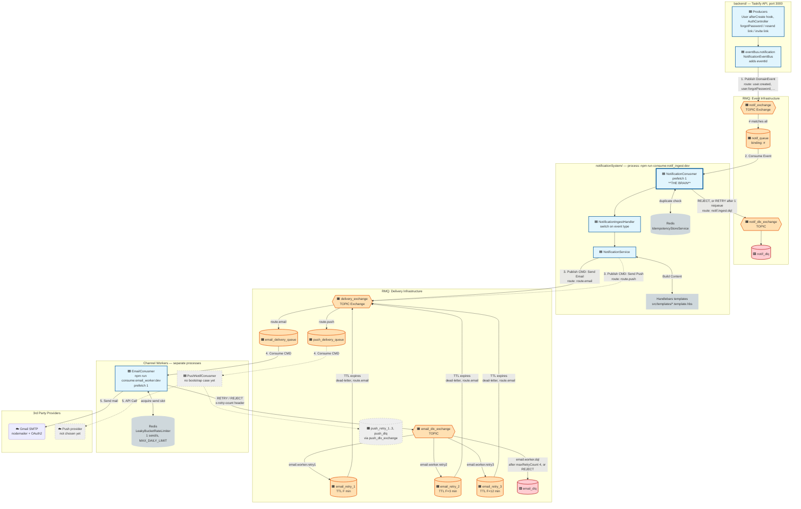

# Notification system design (current implementation)

Names match the code: topology in `src/config/rabbitMQ.ts`, routing keys in `src/infrastructure/rabbitMQ/routingKeys.ts`. Dashed lines are parts that exist in code but don't run yet. Open bugs are listed in [docs/KNOWN_ISSUES.md](../docs/KNOWN_ISSUES.md).

## Changes from the original design

| Original design | Current implementation |
|---|---|
| `ex.app.events` | `notif_exchange` (topic) |
| `q.notifications.ingest` | `notif_queue`, bound with `#` |
| `ex.notifications.delivery`, **DIRECT** | `delivery_exchange`, **TOPIC** |
| `q.delivery.email` / `q.delivery.push` | `email_delivery_queue` / `push_delivery_queue` |
| Routing keys `email` / `push` | `route.email` / `route.push` |
| Ingest worker checks a **User Prefs DB** | No preference check. The worker uses Redis only for duplicate detection. |
| SendGrid / SES | Gmail through nodemailer (OAuth2), with a Redis rate limiter |
| Firebase FCM push worker | `PushNotifConusmer` exists but its handler is commented out and nothing starts it |
| No failure paths | `notif_dlq`; email retry queues `email_retry_1..3` with TTLs, then `email_dlq` |

## Status of each part

- **Ingest** (`npm run consume:notif_ingest:dev`): runs. It needs `RABBITMQ_EMAIL_RETRY_DELAY_FACTOR_MIN` and `RABBITMQ_PUSH_RETRY_DELAY_FACTOR_MIN` set, and the `user.created` template filename is misspelled, so those events currently go to `notif_dlq`.
- **Email worker** (`npm run consume:email_worker:dev`): fails at startup because the retry-queue TTLs are absolute timestamps (B2). After that is fixed, the idempotency bug (B7) would drop emails.
- **Push worker**: not started anywhere. Push messages would sit in `push_delivery_queue`.
- `F` is `RABBITMQ_EMAIL_RETRY_DELAY_FACTOR_MIN` in minutes. Push retry TTLs use `RABBITMQ_PUSH_RETRY_DELAY_FACTOR_MIN` ×1, ×2, ×3.

The fuller cross-service diagram is in [docs/events/events.map.md](../docs/events/events.map.md).
